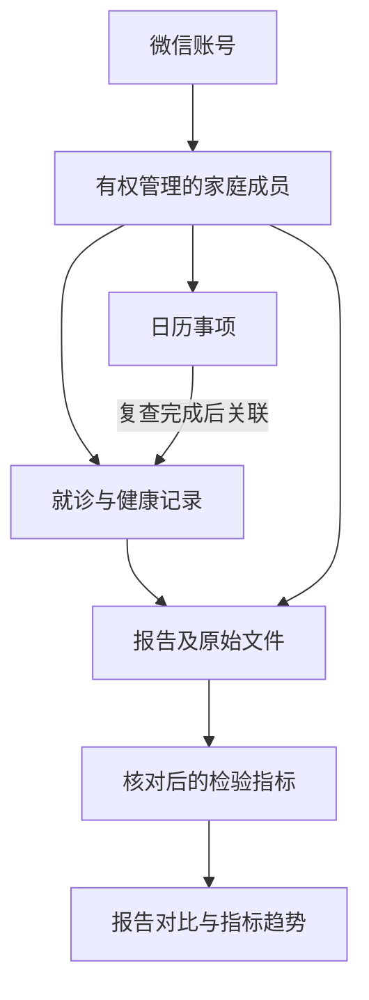
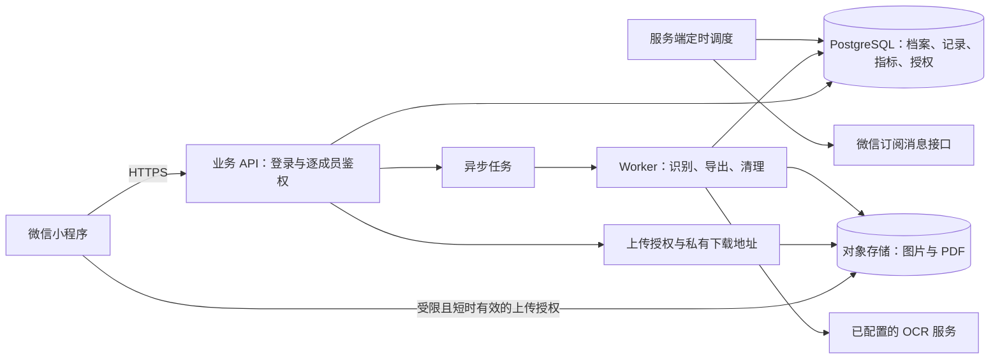

# 个人家庭健康管理小程序方案

> 项目名称：愈之路。面向个人及家庭，支持本人记录，也支持在获得相应授权后管理家人的健康资料。
>
> 版本：V1.0；日期：2026-10-30。
>
> 实现进展：已开始本地版本开发，运行方法和当前功能范围见 [README.md](./README.md)。本地阶段使用 Node.js 内置 SQLite，无需云账号；下文的 PostgreSQL、云存储、微信登录、OCR、消息提醒及生产权限方案仍属于后续接入内容。
>
> 依据：用户提供的「愈之书」首页、日历、健康档案三张截图，以及已确认的个人及家庭使用定位。截图用于分析可见的信息布局，无法据此确认参考产品的后台实现、完整功能或实际数据能力。

## 一、建议与产品定位

建议做成“家庭健康资料库 + 就诊时间线 + 复查与用药日历 + 检验指标对比”的微信小程序。核心价值是把散落在相册、纸张和不同医院系统中的资料集中保存，在复诊时能快速找到，在日常生活中能知道下一件需要完成的事情。

以每个家庭成员为独立的资料主体；一次就诊可以关联症状、就诊记录、检验报告、影像报告、处方和复查事项；各次报告中的已确认指标汇入同一人的趋势图。

本产品中的“病历”指用户保存的就诊资料与记录，不替代医院正式电子病历，也不自动生成医生诊断或调整治疗方案。首版先把记录、查找、对比和提醒做好。

### 典型使用过程

1. 为妈妈建立健康档案，记录已知过敏史、既往史和当前用药。
2. 就诊当天拍摄门诊病历和检验单，选择妈妈，填写医院、科室和就诊日期。
3. 原始文件上传到服务器并归档；支持的报告进入文字与指标识别流程。
4. 用户核对姓名归属、检验日期、指标、单位和参考范围，确认后生成结构化报告。
5. 查看尿酸等指标的历史变化，或并排查看两份生化报告。
6. 根据医生安排手动设置下次复查，完成后关联新报告，形成连续记录。

## 二、参考产品的布局与本项目取舍

| 参考截图中可见的设计 | 建议采用的方式 | 本项目的补充 |
| --- | --- | --- |
| 顶部“本人”切换 | 全局家庭成员选择器 | 上传、对比、日历、搜索始终显示当前成员，防止资料归错人 |
| 首页指标卡片 | 展示最近一次结果及其日期，支持选择关注指标 | 提示待核对数据；首页只采用已确认、可比较的结果 |
| “导入第一份报告”入口 | 将资料导入作为核心操作 | 同时支持拍照、相册、文件选择，具体入口受微信客户端能力限制 |
| 日历周/月切换与今日事项 | 提供复诊、检查、用药和待办 | 事项可以关联就诊记录或报告，记录完成、跳过、改期状态 |
| 档案的记录查询、报告存档、指标趋势 | 保留三种视角 | 三个入口共用底层资料，不要求用户重复录入 |
| 底部中央加号 | 作为快速新增入口 | 新增报告、就诊记录、健康记录和日历事项 |
| 登录保存提示 | 可保留独立演示入口 | 演示资料与真实档案隔离；上传真实资料前登录 |

视觉上采用浅色背景、柔和绿色、清晰卡片和较大字体，减少录入压力。沿用成熟的信息组织方式，品牌名称、图标、文案和具体页面重新设计。

## 三、页面结构

底部导航采用“首页 / 日历 / ＋ / 档案 / 我的”。“＋”是操作菜单，不是一个空白页面。

| 页面 | 核心内容 | 主要操作 |
| --- | --- | --- |
| 首页 | 当前成员、今日事项、待核对报告、关注指标、最近就诊 | 导入资料、记录就诊、查看趋势 |
| 日历 | 周/月视图、按天排列的事项、事项类型和状态 | 新建、完成、跳过、改期、关联资料 |
| 快速新增 | 报告、就诊记录、症状/体征、日历事项 | 在填写前确认成员 |
| 档案－记录查询 | 按日期排列的就诊和健康记录 | 按时间、医院、科室、标签筛选 |
| 档案－报告存档 | 检验、影像、病理、处方和其他资料 | 查看原件、修改分类、关联就诊、选择对比 |
| 档案－指标趋势 | 指标检索、历史值、单指标曲线 | 切换时段、查看来源报告与参考范围 |
| 我的 | 家庭成员、账号、隐私授权、数据导出与删除 | 管理成员、设置默认成员、查看服务状态 |

### 首页建议

从上到下依次展示：成员切换、今日事项、待核对资料、关注指标、最近记录。新用户没有数据时，以“建立成员 → 上传第一份资料 → 核对 → 设置复查”引导，不用空图表占据页面。

指标卡片必须同时显示结果、单位、检验日期和来源。对比箭头表示相对上次的数值变化，不能仅凭升降断言健康变好或变差。异常值也用文字或符号提示，避免只依赖红绿色。

### 家庭成员管理

首版支持一个账号管理多个已获授权的家庭成员，分别保存昵称、关系、出生日期或年龄信息、生理性别（确有检验参考需求时）等资料。非必要不收集身份证号、精确住址等信息。

档案内可记录既往史、过敏史、手术史和当前用药，并标明由谁、何时填写。缺失信息显示“未填写”，不自动视为“无”。

跨账号邀请其他家人共同管理放到后续版本；数据库从第一天预留成员访问授权。家庭关系标签本身不代表有访问权限，成年人及未成年人的授权与监护关系需分别处理。

## 四、首版功能范围

| 模块 | 首版上线内容 | 后续扩展 |
| --- | --- | --- |
| 账号与成员 | 微信登录、本人及多个家庭成员、成员切换 | 跨账号邀请、只读/可编辑权限、访问撤销 |
| 就诊与健康记录 | 日期、医院、科室、原因、诊断摘录、医生建议、标签、附件 | 更丰富的专病记录模板 |
| 报告归档 | 图片/PDF 上传、原件浏览、分类、时间筛选、关联就诊、搜索 | 更复杂的批量整理、细粒度全文搜索 |
| 结构化录入 | 手动录入与修改常见检验指标；保留原件来源 | 更多医院版式与专科项目 |
| OCR 辅助 | 选择少量常见检验报告进行识别，用户确认后生效；失败可手动录入 | 版式覆盖提升、拆单建议、术语辅助映射 |
| 报告对比 | 同一成员的检验指标并排对比和单指标趋势；其他报告提供原文对照 | 更丰富的统计和专题视图 |
| 日历 | 复诊、检查、用药、待办；一次性及常见每日/每周重复 | 复杂治疗周期与长期随访计划 |
| 数据管理 | 私有云端保存、导出原件和结构化数据、删除入口 | 可撤销、限时分享及访问记录 |

首版不安排医院系统自动同步、在线问诊、药品推荐、自动诊断或影像阅片。影像与病理报告可以归档并进行原文对照，但不承诺通用自动医学比较。

如果工期需要压缩，优先缩小 OCR 模板覆盖、提醒重复规则和筛选项；仍保留上传原件、手动校对、报告对比和云端保存的完整流程。

## 五、病历、报告、指标和日历如何关联

- 就诊记录是一次就医事件，可关联多份报告、处方和照片。
- 报告是一次具体的检验或资料对象，可以暂时不关联就诊，后续再整理。
- 原始文件是证据来源；一张图片或一个 PDF 不一定等于一份报告，可能有多页或多份检验内容。
- 指标是报告中的结构化结果，用于对比和检索，不脱离来源单独解释。
- 日历事项负责安排时间与记录执行状态，不等同于已经发生的就诊。

上传时间、就诊时间、采样时间和报告签发时间分别存储。趋势优先使用采样/检验时间；缺失时由用户补充或明确标注采用报告时间，不用上传日期代替检验日期。

## 六、报告导入与对比设计

### 1. 导入流程

选择成员 → 拍照/选择图片或 PDF → 上传原件 → 填写或识别基本信息 → 提取指标 → 用户核对 → 确认归档 → 更新对比与趋势。

服务端保存明确的处理状态：上传中、已上传、识别排队、识别中、待核对、已确认、失败。原件上传成功后即可查阅；OCR 排队或失败不能导致原件丢失。

多页资料可由用户合并为同一份报告，也可拆分。以文件摘要提示可能重复的上传，但最终由用户判断是否重复，不自动删除。

### 2. OCR 的职责边界

OCR/文档识别用于辅助提取：姓名提示、医院、检验日期、项目名称、结果、单位、参考范围及异常标记。姓名只用于提示核对，不能据此自动把资料移到另一个家庭成员名下。

首先验证常见血常规、生化等报告的识别质量，并公布已支持范围。低置信度、缺少单位、范围格式异常、来源文字不清楚等情况突出显示；不依赖一个总体置信度判断整份报告可靠。

保留原始文本、字段来源、页码与区域位置（识别服务可提供时）、识别版本和用户修改记录。不清晰的数值留空并要求核对，不凭上下文补写。

首版仅让已确认的结构化结果进入正式趋势。识别重试不能覆盖用户已经修正的数据；修改已确认的指标后重新计算对比，并保留修订历史。

### 3. 指标对齐规则

可比较性至少由“标准指标编码 + 标本类型 + 可兼容的测量方法 + 单位/量纲”共同决定。项目名称相似只能作为候选匹配，不直接当作同一指标。

| 问题 | 产品和数据处理规则 |
| --- | --- |
| 同项异名，例如 LDL-C 与低密度脂蛋白胆固醇 | 使用受维护的指标词典和别名映射；不确定时保持未匹配 |
| 单位不同 | 仅对已审核的特定指标使用明确换算规则，保留原始值及原单位 |
| 同一个名称但标本或方法不同 | 提示差异；无法确认可比时分组展示，不连成同一趋势线 |
| 不同医院参考范围不同 | 每一条结果保留该报告自己的范围，不统一套用一个范围 |
| 年龄、性别或其他状态影响参考范围 | 以报告给出的范围为原始依据，保留必要的检验时点信息，避免用当前年龄覆盖历史 |
| “＜0.01”“＞1000”等结果 | 保留比较符号和阈值，作为有界结果展示，不当作精确数值计算变化率 |
| 阴性/阳性、分级或文字结果 | 逐项并列展示，通常不使用连续数值折线 |
| 某次没有该项目 | 显示“未检测/未录入”，不填 0、不自动插值 |
| 同一天有多次检验 | 保留多条结果及具体时间、来源；不简单平均 |
| 原报告异常标记与结构化判断不一致 | 同时保留来源信息并提示复核，不静默改写 |

### 4. 对比页面

支持同一成员选择 2～5 份已确认的检验报告，按检验时间排列。首版默认推荐同类报告，不能跨成员对比。手机上采用固定指标名、横向切换报告列的布局，避免把大量数值压缩到一屏。

上部显示日期、医院、标本及可比性提示；主体为指标表，可筛选全部、关注、异常和共同项目。每个单元格包含数值、单位、该次参考范围及来源异常标记。某项未在全部报告出现时明确留空。

数值完全可比时才显示绝对变化；百分比属于辅助项，基线为 0、结果有界或语义不适用时不计算。不把“升高”“降低”自动解释为改善或恶化。

点击指标进入趋势页，展示各次采样日期、结果和原报告链接。参考范围变化时逐点展示或分段标记，不绘制误导性的统一正常区间。避免把不同单位的多种指标混在一条纵轴上。

趋势首版提供确定性的描述，例如“本次比上次增加 0.07 mmol/L”，不自动生成疾病诊断、疗效结论或停药建议。

对于影像、病理、门诊病历等文字资料，首版支持选择同一成员的两份原件进行对照。手机端提供快速切换或上下分区浏览，始终显示日期及来源，并允许用户标记重点。文字内容相似或变化不等于医学结论，不自动推断病情进展。

## 七、日历与提醒设计

| 事项类型 | 主要字段 | 完成后的关联 |
| --- | --- | --- |
| 复诊 | 日期时间、医院/科室、备注、提醒偏好 | 关联实际就诊记录 |
| 检查/复查 | 日期时间、项目、准备事项原文 | 关联新报告 |
| 用药 | 药品名称、用户或处方记载的剂量/频次、起止日期、计划时间 | 记录当次完成或跳过 |
| 普通待办 | 标题、截止时间、备注 | 可关联资料，也可独立存在 |

用药计划不推导或推荐剂量；修改重复事项时区分“仅本次”和“从此以后”。重复计划与每天的执行实例分开保存，已完成的历史记录不随计划修改而消失。

默认使用 Asia/Shanghai 时区，数据库保存明确的时间及时区语义；全天事项与具体时刻事项区分。客户端显示待办状态，服务端定时任务负责到期扫描、消息尝试与防重复。

微信订阅消息依赖用户授权、可用模板以及平台当时允许的发送条件，不能把所有用药安排等同于必定送达的每日提醒。授权不足时，仍提供小程序内待办；准确提示提醒能力，不显示“保证提醒”。微信规则和类目可用性需在实际申请时核验。

首版不默认发送短信或微信聊天消息。跨账号照护者提醒、额外通知通道另行设计。

## 八、服务器与技术架构

### 推荐技术组合

| 层次 | 建议选型 | 理由 |
| --- | --- | --- |
| 小程序前端 | 原生微信小程序 + TypeScript + 成熟组件库 | 目标平台明确，便于使用登录、上传和订阅消息能力 |
| API 后端 | Node.js + TypeScript，采用 NestJS 等成熟框架 | 团队可统一语言，便于权限、接口校验和异步任务组织 |
| 业务数据库 | 托管 PostgreSQL | 适合成员、授权、就诊、报告和指标之间的关系与查询 |
| 原件存储 | 腾讯云 COS 等私有对象存储 | 保存图片/PDF，支持容量扩展、访问控制和生命周期管理 |
| 异步处理 | 独立 Worker + 任务队列 | OCR、导出、缩略图与清理任务不阻塞用户请求 |
| OCR | 先对国内文档识别服务做样本验证，再选择供应商 | 识别质量、医院版式、数据处理条款和成本都要验证 |
| 运维 | 托管数据库、集中日志、告警、自动备份 | 降低小团队维护负担 |

推荐优先在同一个中国大陆云地域部署应用、数据库与对象存储，减少跨地域数据流转和内部通信成本。初期采用模块化单体 API 加独立 Worker，暂不拆分微服务。

低并发内测可用 PostgreSQL 作业表配合领取锁、重试和超时回收实现任务队列；增长后再引入托管队列。Redis 不是首版的必选依赖。

如果团队已有成熟技术栈，可保留同样的数据模型与边界，替换为 Java、Go 等后端，不必为这份方案重建团队能力。

### 架构示意

### 登录与文件访问

1. 小程序获取微信登录 code，交由后端完成登录校验；后端签发本系统会话。OpenID 是身份映射，不作为下载文件的凭证。
2. 前端请求为当前成员创建上传任务，后端检查用户权限，生成唯一文件记录及受限制的短时上传授权。
3. 文件直传私有对象存储，前端确认完成；后端核实对象确实存在，检查实际大小、类型和归属，再标记上传成功并创建处理任务。
4. 客户端打开原件时重新调用后端鉴权，获得短时有效的读取地址。过期后需要重新鉴权获取地址。
5. 列表缩略图、导出文件、OCR 任务也使用相同的成员权限边界，不能通过知道文件 ID 绕过权限。

不把数据库密码、对象存储长期密钥或 OCR 密钥放在小程序中。签名地址会在有效期内提供访问能力，应缩短有效期并避免写入日志；如后续需要即时撤销文件访问，采用经后端逐次授权的下载方式。

### 其他部署方案的取舍

| 方案 | 适用情况 | 主要取舍 |
| --- | --- | --- |
| 微信云开发一体化方案 | 小团队快速试点，已有该栈经验 | 需根据其数据能力重新落实模型、权限、异步流程、迁移与费用估算 |
| 云服务器/容器 + 托管数据库 + 对象存储（推荐） | 计划持续迭代的家庭健康产品 | 初始搭建工作更多，查询、导出和服务迁移的控制更充分 |
| 全部组件自行运维 | 已有成熟运维团队 | 日常安全更新、备份恢复和故障处理投入较高 |

## 九、核心数据模型

| 实体 | 主要内容 |
| --- | --- |
| User | 微信身份映射、会话关联、账号状态 |
| Patient | 家庭成员基础信息、创建者、默认展示信息；不等同于登录账号 |
| PatientAccess | 用户与成员的访问关系、角色、授权来源、撤销时间 |
| HealthProfile | 过敏、既往史、手术史、当前用药等用户维护的档案信息 |
| Encounter / HealthEntry | 就诊事件、症状与体征记录、日期、医院科室、文字内容 |
| Report | 成员、类别、检验时间、报告时间、医院、标本/方法信息、处理状态 |
| FileAsset / ReportFile | 对象存储键、文件摘要、格式、大小、页序和报告关联 |
| MetricDefinition | 标准指标编码、别名、结果类型、允许的单位换算规则 |
| Observation | 来源报告、指标编码、原始名称、原始值/单位、可选标准化值、参考范围、异常标记、核对状态 |
| Schedule / Occurrence | 重复规则、单次执行实例、完成/跳过记录、来源资料关联 |
| Job / NotificationAttempt | OCR/导出等作业状态，通知授权与发送尝试，重试与幂等键 |
| Consent / AuditLog | 告知同意记录、关键访问与修改记录；日志避免保存完整报告内容 |

Observation 不只存一个浮点数。建议分别保存结果类型、比较符号、十进制数值、文本值、原始显示字符串和原始单位；标准化后的数值另存。指标字典和换算规则带版本，便于追溯历史展示依据。

实体以稳定 ID 关联，家庭成员 ID 贯穿业务数据；API 与后台任务每次读写都校验其权限。首版可不开放跨账号共享界面，但不把“创建者 ID”作为未来所有权限规则的唯一依据。

服务器保存完整资料，小程序本地仅保留必要且可清理的缓存；切换设备后经登录和权限校验读取云端数据。成员切换或退出登录时清理对应的敏感缓存。

结构化信息放数据库，文件二进制放对象存储。成员、检验日期、指标编码等建立适用索引；业务更改采用版本号或更新时间冲突检测，避免多人编辑时静默覆盖。

## 十、隐私、数据可靠性与发布准备

健康医疗资料属于敏感个人信息，保护措施应进入产品设计和实现，而非上线后补做。以下是本产品直接需要落实的内容：

- 上传前清楚说明收集什么、用于什么、存放和处理方式以及删除入口，按适用法律落实单独同意等要求。代理管理家人资料和未成年人资料分别设计授权路径。
- 真实文件默认私有，不生成永久公开链接；应用、数据库和对象存储使用最小权限，开发和生产环境隔离。
- 使用 HTTPS、存储加密和妥善的密钥管理。日志不记录原报告内容、完整临时下载链接或登录凭证。
- 若启用第三方 OCR/AI，把实际服务商及必要的数据处理告知纳入流程，核验处理地域、保留期限、分包和模型训练条款。只向选定服务发送完成识别所需的数据；选择手动录入的用户无需启用该处理。
- 校验上传文件的真实格式、大小、页数和资源占用，限制单用户请求与并发；扫描、预览转换放在受控环境执行。
- 导出按成员生成含原件、文件索引和结构化记录的资料包，经鉴权下载并设置短期有效时间。大包异步生成，过期后清理临时导出物。
- 删除覆盖数据库、对象文件、缩略图、缓存与第三方处理副本（按实际服务能力和约定）；备份按事先说明的保留周期到期清理，不承诺点击删除后所有备份立即物理擦除。
- 备份覆盖数据库及原件，并进行恢复演练。恢复旧备份时重放删除记录，防止已删除资料重新对用户可见。
- 保存修改审计和关键处理记录，支持定位误操作；管理员维护采用最小必要权限，不默认开放浏览用户病历的后台。

正式发布前，确认小程序主体、实际服务类目、隐私保护指引、所需备案及域名/服务器要求。ICP备案、APP/小程序备案与健康相关服务类目要求不能相互替代；以届时微信平台和主管部门规定为准。本方案未对当前平台审核政策进行在线核验。

仅做个人健康资料记录与涉及诊疗、处方或疾病预测的业务，产品边界不同。若未来扩展业务，再重新评估相关要求。

## 十一、容量、成本与运行目标

### 成本由哪些部分组成

每月费用约等于：应用计算 + 数据库 + 对象存储 + 文件读取流量 + 备份 + OCR 处理量 + 日志监控；短信、额外 AI 服务等另计。

举例：1,000 位活跃用户，每人每月上传 10 份报告，每份平均 2 页、每页原图 2 MB，则每月新增约 40 GB 原图，全年约 480 GB。这个估算尚未包含缩略图、文件版本、备份、PDF 体积差异和上传峰值。

同样的用量对应每月约 20,000 页 OCR，重试与重复处理还会增加调用量。因此不应只估计一台云服务器的费用。

### 预算建议

以下仅是方案阶段的月度预算占位，不是云厂商报价，也不是成本承诺；地域、配置、套餐、流量和识别覆盖都会改变费用。

| 阶段 | 预算安排方式 |
| --- | --- |
| 个人自用或数十人的内测 | 可先预留数百元级/月基础设施预算，并限制文件容量及 OCR 调用量 |
| 数百至上千用户的试运行 | 先预留千元级/月及可调整空间，按真实新增页数与下载量核算 |
| 持续增长 | 用真实账单建立单活跃用户成本和单报告处理成本，设置阈值告警 |

采购前用候选云服务的实际报价替换占位数字。优先在开发初期完成一个月度用量测算，明确免费额度用完后的成本；开发人工、小程序主体相关费用与这些运行费用分开核算。

### 运行目标

试运行阶段先按约 1,000 个活跃账号的业务规模设计，并通过真实文件大小和并发上传场景做负载验证。该数字是容量规划起点，不代表已经完成性能验证。

建议将数据库恢复点目标设为不超过 24 小时、恢复时间目标设为 4～8 小时；能否达到要由备份配置、原件保存策略和演练结果确认。根据实际使用要求，再提升备份频率或可用性配置。

## 十二、开发顺序与交付物

以下按 1 名熟悉小程序及后端的全栈开发者，加兼职设计和测试估算；用于安排工作，不含不可控的平台审核时间。代码经验、报告版式数量和设计精细度会影响工期。

| 阶段 | 参考时间 | 交付物 |
| --- | --- | --- |
| 需求与原型 | 第 1 周 | 页面流程、字段表、授权边界、代表性脱敏报告样本、首版验收范围 |
| 账号与资料底座 | 第 2～3 周 | 登录、成员管理、私有上传、原件预览、数据库、测试环境 |
| 就诊、档案与日历 | 第 4～5 周 | 就诊时间线、分类查询、事项重复与完成、资料关联 |
| 指标与报告对比 | 第 6～7 周 | 手动核对、指标字典、并排对比、单指标趋势 |
| OCR 试点与数据管理 | 第 8～9 周 | 选定报告类型的识别流程、导出、删除、备份恢复 |
| 集成验收与试运行 | 第 10～12 周 | 权限检查、真机与弱网验证、缺陷修复、发布材料 |

建议完整内测版本预留约 8～12 周。可在资料底座完成后邀请少量用户试用上传与查找，但完整验收仍包含报告对比和日历。若希望更快验证，先缩小自动识别覆盖，不压缩数据归属校验和原件保存流程。

第二阶段再评估跨账号家庭协作、限时分享、更多报告版式、复杂用药周期和有实际需求的专题档案。待用户验证价值后，再决定医院系统集成或医生端。

## 十三、首版验收标准

1. 一个账号能管理本人及已授权的家人；切换后首页、档案、日历和搜索一致变化，甲成员资料不会出现在乙成员列表或对比中。
2. 图片和 PDF 在上传后可从另一台已登录设备查看；弱网、上传中断、重复提交和 OCR 失败有可恢复路径，未上传完整的文件不被标记为成功。
3. 一次就诊能关联多份资料，也能把先上传的报告补关联到历史就诊。
4. 核对报告后，对比和趋势使用确认结果；修改后可追溯来源，后台识别重试不会覆盖人工修正。
5. 同项异名、不同单位、不同参考范围、定性结果、有界数值、缺失项目和不同检测方法均按设计展示，不产生伪造数值或误导性连线。
6. 日历的一次性和重复事项能够完成、跳过、改期；历史状态保留，未获授权的微信提醒有准确提示。
7. 修改请求中的成员 ID、报告 ID 或文件 ID 不能读取或覆盖无权访问的资料；原件和导出物不能匿名长期访问。
8. 用户能够导出和删除指定成员资料；删除范围与备份保留说明一致，备份恢复演练通过。
9. 提供少量真实使用者的完整流程验证，尤其关注拍多页、日期误识别、单位缺失、长辈字号和一手操作。

识别评估分别统计日期、成员姓名提示、项目映射、数值、单位和参考范围的字段正确率，并衡量整份报告需要多少次人工修正。不要仅用一个笼统的“OCR 准确率”作为验收结论。

## 十四、建议先确定的实施决策

已确定：个人与家庭使用、小程序形态、云端保存、病历/日历/档案/报告对比四个核心方向。

本方案采用的首版默认值：

- 产品名称“愈之路”，原生微信小程序，腾讯云为首选部署方向。
- 一个账号管理多位家庭成员；跨账号协作后续开放。
- 先支持检验报告的结构化对比，影像/病理以原件归档为主。
- 原件始终保留，结构化字段由用户确认；OCR 覆盖从少量报告类型起步。
- 基础档案与上传完成后即可内部试用，完整首版再加入趋势、日历和数据管理。

开始编码前，用几份获得授权并脱敏的代表性报告完成识别与对比验证，同时确定可投入的人力及月度运行预算。这两项会决定具体 OCR 服务、模板数量和交付节奏。
